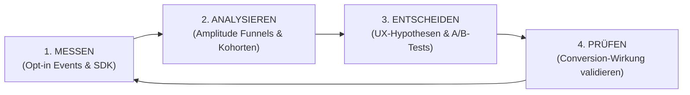
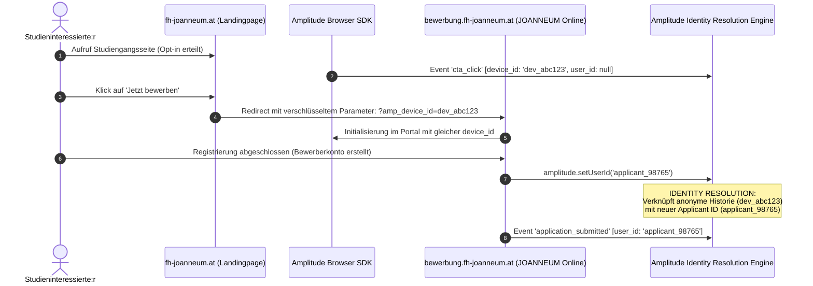

# Web-Analytics-Strategie für die FH JOANNEUM: „Von der Studiengangsseite zur Onlinebewerbung“
## Umfassende Präsentationsdokumentation & Strategiepapiere (Amplitude Analytics Edition)

**Studiengang / Lehrveranstaltung:** Web Analytics · Group Assignment 1  
**Hochschule:** FH JOANNEUM Gesellschaft mbH  
**Fokus-Pfad:** Studiengangsseite (`fh-joanneum.at/software-design-cloud-computing`) $\rightarrow$ Bewerbungsportal JOANNEUM Online (`bewerbung.fh-joanneum.at`)  
**Teammitglieder:** Inas Badnjevic, Lukas Linzer, Katharina Golger, Magdalena Pollhammer  
**Analytics-Plattform:** Amplitude Analytics (Browser SDK v2 / EU Cloud Data Residency)  
**Live-Prototyp:** [https://hyazintch.github.io/webanalytics-milk/](https://hyazintch.github.io/webanalytics-milk/)  
**Amplitude API-Key:** `5d5391da281ba4724ecdfbae4cc3a7cd` (EU Server Zone)

---

## Inhaltsübersicht der Folienstruktur

| Folie | Schritt | Thema | Hauptverantwortung |
|---|---|---|---|
| **Folie 1** | Intro | Titelblatt & Team | Person 1 |
| **Folie 2** | Schritt 1 | Unternehmen & Website (FH JOANNEUM) | Person 1 |
| **Folie 3** | Schritt 1 | Zielgruppen & Erfolgs-Interaktionen (Macro- & Micro-Conversions) | Person 1 |
| **Folie 4** | Schritt 2 | SMART-Ziele: Unternehmens- und Nutzerperspektive | Person 1 |
| **Folie 5** | Schritt 2 | Verhaltensdaten, Performance-Monitoring & organisatorische Verankerung | Person 1 |
| **Folie 6** | Schritt 2 | Der datengestützte Entscheidungskreislauf | Person 1 |
| **Folie 7** | Schritt 3 | Zielgruppen-Segmentierung & datenbasierte Größenschätzung | Person 1 |
| **Folie 8** | Schritt 3 | 7 Kern-KPIs zur Erfolgsmessung | Person 1 |
| **Folie 9** | Schritt 3 | Reporting-Architektur & Entscheidungszyklen | Person 1 |
| **Folie 10** | Schritt 4 | Tool-Wahl: Warum Amplitude Analytics? (Vergleich zu GA4 & Matomo) | Person 2 |
| **Folie 11** | Schritt 4 | Datenschutz, DSGVO & Amplitude EU Data Residency | Person 2 |
| **Folie 12** | Schritt 4 | Prototyp-Architektur & Implementierung | Person 2 |
| **Folie 13** | Schritt 4 | Technische Tracking-Dokumentation & Event-Schema | Person 2 |
| **Folie 14** | Schritt 4 | Leitfaden für die Live-Demo des Prototyps | Person 2 |
| **Folie 15** | Schritt 5 | Datenanalyse I: Der 5-stufige Conversion-Funnel in Amplitude | Person 3 |
| **Folie 16** | Schritt 5 | Datenanalyse II: Segmentvergleich – Mobile vs. Desktop Disparität | Person 3 |
| **Folie 17** | Schritt 5 | Prototyp-Validierung im Amplitude Real-Time Event Stream | Person 3 |
| **Folie 18** | Schritt 5 | Handlungsempfehlungen für die FH JOANNEUM | Person 3 |
| **Folie 19** | Schritt 6 | Methodische & technische Herausforderungen | Person 3 |
| **Folie 20** | Schritt 6 | Diskussionserkenntnisse & Peer-Feedback (Post-Presentation Update) | Person 3 |
| **Folie 21** | Schritt 6 | Cross-Domain Identity Resolution & User ID Bridging in Amplitude | Person 3 |
| **Folie 22** | Schritt 6 | Interaktive Fragen für die Diskussionsrunde | Person 3 |
| **Folie 23** | Anhang | KI-Deklaration & Quellenverzeichnis | Alle |

---

<!-- SLIDE BREAK -->

# TEIL 1: GRUNDLAGEN, ZIELE & SEGMENTIERUNG (Person 1)

---

### [FOLIE 1: TITELBLATT]

#### Visuelle Gestaltung & Layout
* Dunkelblauer Header im FH-CI (`#002b49`), weiße Typografie, klare moderne Badge-Akzente.
* Titel: **Web-Analytics-Strategie für die FH JOANNEUM**
* Untertitel: *Von der Studiengangsseite zur Onlinebewerbung – Datengetriebene Optimierung des Rekrutierungs-Funnels mit Amplitude Analytics*

#### Kerninhalte der Folie
* **Institution:** FH JOANNEUM – University of Applied Sciences, Graz / Steiermark
* **Lehrveranstaltung:** Web Analytics (Group Assignment 1)
* **Projektteam:** Inas Badnjevic, Lukas Linzer, Katharina Golger, Magdalena Pollhammer
* **Präsentationsdatum:** 13. November 2026 (Aktualisierte Abgabe: 16. November 2026)
* **Technologie-Fokus:** Modern Product Analytics mit Amplitude (EU Cloud Residency) & GitHub Pages Prototyp

#### Sprechernotizen (Person 1)
> „Schönen Vormittag allerseits und herzlich willkommen zu unserer Präsentation im Fach Web Analytics!  
> Mein Name ist [Name], und gemeinsam mit meinem Team – Inas, Katharina, Lukas und Magdalena – haben wir für das erste Group Assignment eine umfassende, praxisnahe Web-Analytics-Strategie für die FH JOANNEUM ausgearbeitet.  
> Unser gewählter Schwerpunkt lautet: *‚Von der Studiengangsseite zur Onlinebewerbung‘*. Wir beleuchten heute den gesamten digitalen Entscheidungsweg von Studieninteressierten – vom ersten Informationseinstieg bis zum qualifizierten Absenden der Bewerbung – und zeigen, warum moderne Product-Analytics-Tools wie Amplitude Analytics hierfür der entscheidende Hebel sind.“

---

### [FOLIE 2: SCHRITT 1 – UNTERNEHMEN UND WEBSITE]

#### Visuelle Gestaltung & Layout
* Zweispaltiges Layout: Links Kennzahlen zur Hochschule; rechts Website-Architektur und Fokus-Pfad.
* Highlight-Box: 266.000 monatliche Besuche & Relevanz der Studiengangsseiten.

#### Kerninhalte der Folie
* **Über die FH JOANNEUM:**
  * Eine der führenden Fachhochschulen Österreichs mit Standorten in **Graz, Kapfenberg und Bad Gleichenberg**.
  * Rund **1.991 Studienanfänger:innen im Studienjahr 2024/25** (~8 % aller 23.344 FH-Erstsemestrigen in Österreich; Quelle: Statistik Austria / Jahresbericht).
* **Die zentrale digitale Drehscheibe:**
  * Domain: `fh-joanneum.at`
  * Traffic-Größenordnung: Durchschnittlich ca. **266.000 Besuche pro Monat** (Semrush Schätzung Juli–September 2026).
  * Traffic-Aufteilung: 63 % Direktzugriffe (primär bestehende Studierende & Bedienstete für Intranet/Mail/Moodle), 27 % organische Google-Suchen (Kernkanal für Neugewinnung).
* **Strategischer Fokuspfad:**
  * Der kritische Übergang: **Studiengangsseite (fh-joanneum.at) $\rightarrow$ Onlinebewerbung (JOANNEUM Online Portal)**.
  * Genau an dieser Schnittstelle entsteht der geschäftskritische Mehrwert: Hier entscheidet sich, ob Informationssuchende abspringen oder qualifizierte Bewerber:innen werden.

#### Sprechernotizen (Person 1)
> „Beginnen wir mit Schritt 1: dem Unternehmen und der Ausgangssituation.  
> Die FH JOANNEUM bildet mit ihren drei steirischen Standorten jedes Jahr rund 2.000 Erstsemestrige aus. Die offizielle Website `fh-joanneum.at` ist das vitale Aushängeschild der Fachhochschule. Bei über 260.000 Monatsbesuchen ist das Gesamtvolumen zwar hoch, der Großteil davon sind jedoch interne Zugriffe durch Studierende und Mitarbeitende.  
> Unser strategischer Fokus liegt daher gezielt auf den Landingpages der Studiengänge – beispielhaft für den Master ‚Software Design & Cloud Computing‘. Genau hier entscheidet sich, ob aus einem anonymen Klick eine vollständige Bewerbung wird. Hier lohnt sich Web Analytics für die Hochschule am allermeisten.“

---

### [FOLIE 3: SCHRITT 1 – ZIELGRUPPEN UND ERFOLGS-INTERAKTIONEN]

#### Visuelle Gestaltung & Layout
* Kachel-Darstellung der 4 Zielgruppen oben; 2-stufige Conversion-Klassifizierung unten (Macro vs. Micro).

#### Kerninhalte der Folie
* **Die 4 primären Zielgruppensegmente:**
  1. *Maturant:innen & Schulabgänger:innen:* Suchen nach Orientierung, Zulassungsvoraussetzungen, Berufsaussichten.
  2. *Berufstätige:* Suchen nach flexiblen Organisationsformen (berufsbegleitend, geblockte Einheiten, Work-Study-Balance).
  3. *Eltern & Angehörige:* Wichtige Beratungsinstanz bei Bildungsentscheidungen, achten auf Studiengebühren, Renommee und Betreuungsqualität.
  4. *Internationale Interessierte:* Prüfen englischsprachige Curricula, Visabestimmungen, Welcome Services.
* **Klassifizierung der Erfolgs-Interaktionen:**
  * **Macro-Conversion (Primäres Geschäftsziel):**
    * Erfolgreich übermittelte Onlinebewerbung im Bewerberportal (`application_submitted`).
  * **Micro-Conversions (Entscheidungs- und Engagement-Treiber):**
    * Klick auf den prominenten Bewerbungs-CTA (`cta_click` $\rightarrow$ Weiterleitung zu JOANNEUM Online).
    * Start der Registrierung im Portal (`portal_registration`).
    * Download der offiziellen Infobroschüre `Infobroschuere_Bewerbung_Aufnahme.pdf` (`file_download`).
    * Absenden von Informationsanfragen via Webformular (`form_submit`).
    * Hohe inhaltliche Durchdringung der Curriculumsdetails (Scrolltiefe $\ge 75\,\%$).

#### Sprechernotizen (Person 1)
> „Wer bewegt sich auf diesen Seiten und wie definieren wir Erfolg?  
> Ein Hochschulstudium wählt man nicht spontan wie ein T-Shirt im Onlineshop. Der Entscheidungsprozess dauert Wochen oder Monate. Neben Maturant:innen und Berufstätigen recherchieren oft auch Eltern und internationale Interessierte.  
> Das finale Hauptziel – unsere Macro-Conversion – ist natürlich die abgeschickte Bewerbung. Um den langen Weg dorthin aber datenbasiert steuern zu können, brauchen wir messbare Micro-Conversions: Klickt jemand auf den Bewerbungslink? Wird das Curriculum heruntergeladen? Wird das Kontaktformular für den Infoabend abgeschickt? Genau diese Signale spiegeln echtes Nutzer-Commitment wider.“

---

### [FOLIE 4: SCHRITT 2 – SMART-ZIELE]

#### Visuelle Gestaltung & Layout
* Gegenüberstellung zweier KPI-Karten: Links „Unternehmensziel (Business)“, Rechts „Nutzerziel (UX & Performance)“.
* Aufschlüsselung der SMART-Kriterien in einer kompakten Matrix.

#### Kerninhalte der Folie
```
+-----------------------------------------------------------------------------------+
| 1. UNTERNEHMENSZIEL: Steigerung der Bewerbungs-Conversion                         |
| +15 % relative Steigerung der Conversion Rate von Studiengangsseiten-Aufrufen zur |
| abgeschlossenen Onlinebewerbung (Zeitraum: Herbst 2026 bis Ende Bewerbungsfrist   |
| Mai 2027; Baseline-Erhebung im ersten Messmonat).                                 |
+-----------------------------------------------------------------------------------+
| 2. NUTZERZIEL: Schnell und barrierefrei mobil zum Ziel                            |
| Mindestens 75 % aller mobilen Besuche erreichen einen Largest Contentful Paint    |
| (LCP) von <= 2,5 Sekunden. Die mediane Verweildauer bis zum Auffinden des         |
| Bewerbungs-CTAs liegt unter 30 Sekunden.                                          |
+-----------------------------------------------------------------------------------+
```

* **Exakte SMART-Validierung:**
  * **S (Spezifisch):** Klarer Fokus auf den Pfad Studiengangsseite $\rightarrow$ Bewerbungsportal JOANNEUM Online.
  * **M (Messbar):** Conversion Rate und Web Vitals LCP werden automatisiert in Amplitude Analytics quantifiziert.
  * **A (Erreichbar / Achievable):** +15 % relativ bedeutet bei einer angenommenen Conversion Rate von 2,0 % eine Steigerung auf 2,3 % – durch UX-Optimierung und CTA-Hervorhebung absolut realistisch.
  * **R (Relevant):** Direkter Einfluss auf die Studienplatzbelegung und den Bildungsauftrag der FH.
  * **T (Terminiert):** Kampagnen- und Messzeitraum von November 2026 bis 31. Mai 2027.

#### Sprechernotizen (Person 1)
> „In Schritt 2 haben wir zwei zentrale SMART-Ziele definiert – eines aus Sicht der FH und eines aus Sicht der Studieninteressierten:  
> Erstens, das Unternehmensziel: Wir wollen die Conversion Rate von der Studiengangsseite zur abgeschickten Bewerbung um 15 % relativ steigern. Gemessen wird dies über die Bewerbungsphase bis Mai 2027. Bei einer Ausgangsbasis von 2,0 % bedeutet das ein Plus auf 2,3 % – das klingt moderat, bringt der FH aber Dutzende zusätzliche qualifizierte Bewerberinnen und Bewerber.  
> Zweitens, das Nutzerziel: Studieninteressierte informieren sich primär am Smartphone. Wenn eine Seite hakt oder unübersichtlich ist, springen sie ab. Unser Ziel lautet daher: Mindestens 75 % der mobilen Aufrufe müssen eine Ladezeit unter 2,5 Sekunden aufweisen, und der Call-to-Action zur Bewerbung muss im Median in unter 30 Sekunden auffindbar sein.“

---

### [FOLIE 5: SCHRITT 2 – VERHALTEN, PERFORMANCE & ORGANISATION]

#### Visuelle Gestaltung & Layout
* Dreigeteilte Struktur: (1) Tracking-Dimensionen, (2) Performance-Monitoring, (3) Organisations-Chart.

#### Kerninhalte der Folie
* **Erfasstes Nutzerverhalten (Behavioral Event Stream):**
  * `page_view`: Aufruf spezifischer Studiengangsseiten (mit Attributen: Studiengang, Typ, Sprache).
  * `cta_click`: Klick auf „Jetzt bewerben“ oder „Bewerbung & Aufnahme“ (mit Positionsangabe).
  * `form_submit`: Absenden des Beratungs- und Infoanfrageformulars (unter striktem PII-Verzicht).
  * `file_download`: Herunterladen der PDF-Infobroschüre.
  * `scroll_depth`: Scroll-Milestones bei 50 % (Inhalte) und 75 % (Aufnahmevoraussetzungen).
* **Performance-Monitoring (Web Vitals Integration):**
  * Kontinuierliche Überwachung von *Largest Contentful Paint (LCP)*, *Cumulative Layout Shift (CLS)* und *First Input Delay (FID)*.
  * Direkte Korrelation in Amplitude: Brechen Nutzer bei LCP > 4s signifikant häufiger im Trichter ab?
* **Organisatorische Verankerung:**
  * **Hauptzuständigkeit:** Abteilung **PR & Marketing** (Verantwortung für Content, Kampagnen und Conversion-Ziele).
  * **Feste Schnittstellen:**
    * *IT & Web-Development:* Technische SDK-Implementierung, CMS-Templates, Core Web Vitals.
    * *Datenschutzbeauftragte:r (DSB):* TKG- und DSGVO-Compliance, Auditierung der Datenspeicherung in der EU.
    * *Studiengangsleitungen:* Feedback zu Bewerberzahlen und thematischen Interessensschwerpunkten.

#### Sprechernotizen (Person 1)
> „Um diese Ziele zu steuern, erfassen wir konkrete Verhaltensdaten. Wir tracken nicht nur stumpfe Klicks, sondern erfassen das gesamte Interaktionsmuster: Klicks, Scrolltiefe, Downloads und Ladezeiten.  
> Ebenso wichtig ist die Frage: Wo gehört das Web-Analytics-Team organisatorisch hin?  
> Wir plädieren klar für eine Ansiedlung in der Abteilung **PR & Marketing**. Warum? Weil dort über Budgets, Studienangebote und Marketingkampagnen entschieden wird. Das Marketingteam benötigt die Zahlen täglich, arbeitet aber in engem Schulterschluss mit der IT für die technische Implementierung und mit dem Datenschutzbeauftragten für die rechtliche Freigabe.“

---

### [FOLIE 6: SCHRITT 2 – DER ANALYTICS-KREISLAUF]

#### Visuelle Gestaltung & Layout
* Kreislaufdiagramm (Mermaid Flowchart) mit 4 Phasen. Modern, iterativ, datengesteuert.



#### Kerninhalte der Folie
* **Phase 1 – Messen:** DSGVO-konforme Erfassung aller Interaktionen erst nach expliziter Einwilligung via modernem Amplitude Browser SDK.
* **Phase 2 – Analysieren:** Identifikation von Absprungpunkten in Amplitude Funnel Conversion Charts, Kohorten-Vergleiche (Mobil vs. Desktop, Kampagnen vs. Organisch).
* **Phase 3 – Entscheiden:** Ableiten konkreter Optimierungsmaßnahmen (z. B. Sticky CTA Button mobil, Vorab-Checkliste der Bewerbungsunterlagen).
* **Phase 4 – Prüfen:** Vorher-Nachher-Vergleich der Conversion Rate und Time-to-Convert; Nachjustierung der Strategie.

#### Sprechernotizen (Person 1)
> „Web Analytics ist kein einmaliges IT-Projekt, sondern ein kontinuierlicher Management-Kreislauf:  
> Wir **messen** saubere Verhaltensdaten erst nach Einwilligung; wir **analysieren** die Funnels und Kohorten in Amplitude; wir **entscheiden** über konkrete UX-Verbesserungen; und wir **überprüfen** im Anschluss sofort, ob die Maßnahmen die Conversion Rate messbar gesteigert haben.  
> Wie sich nun unsere Zielgruppen zusammensetzen und welche Kennzahlen wir dafür brauchen, betrachten wir in Schritt 3.“

---

### [FOLIE 7: SCHRITT 3 – ZIELGRUPPEN-SEGMENTIERUNG & GRÖSSENSCHÄTZUNG]

#### Visuelle Gestaltung & Layout
* Tabelle der Segmentierungsdimensionen links; Rechenmodell zur Zielgruppengröße mit Callout rechts.

#### Kerninhalte der Folie
* **Relevante Segmentierungsdimensionen:**
  * *Gerätetyp (Device):* Mobile (Smartphones) vs. Desktop vs. Tablet.
  * *Traffic-Kanal (Acquisition Source):* Organic Google Search, Direct, Social Media, Partner/Referral.
  * *Besuchertyp (User Lifecycle):* Erstbesucher:innen (Erkundungsphase) vs. Wiederkehrende Interessierte (Entscheidungsphase).
  * *Geografie (Geo-Location):* Österreich (Kern), Deutschland/DACH, Internationale EU-/Nicht-EU-Länder.
* **Methodische Größenschätzung der Studieninteressierten:**
  * Gesamttraffic `fh-joanneum.at`: $266.000\text{ Besuche/Monat} \times 12 \approx 3.192.000\text{ Besuche/Jahr}$ (Semrush Basis).
  * Bereinigung um interne Nutzer: 63 % Direktzugriffe entfallen primär auf bestehende Studierende & Mitarbeiter:innen $\rightarrow$ verbleiben **37 % externe Besuche** ($\approx 1.180.000\text{ Besuche p.a.}$).
  * Besuche pro Interessent:in: Schätzung von durchschnittlich **3 vertiefenden Besuchen** pro Person während der Orientierungsphase.
  * Geschätzte Zielgruppenbasis: $1.180.000 / 3 \approx \mathbf{393.000}\text{ bis }\mathbf{400.000}\text{ Studieninteressierte pro Jahr}$.
* **Plausibilitäts-Check:**
  * Rund 1.991 tatsächliche Studienanfänger:innen entsprechen **ca. 0,5 % der geschätzten Zielgruppe**. Dieser Wert deckt sich hervorragend mit typischen Hochschul-Funnels im DACH-Raum.

#### Sprechernotizen (Person 1)
> „Kommen wir zu Schritt 3: Der Zielgruppen-Segmentierung und Datenplanung.  
> Um Daten nicht im Aggregat ertrinken zu lassen, segmentieren wir nach Endgerät, Kanal, Nutzertyp und Herkunft.  
> Doch wie groß ist unsere Zielgruppe überhaupt?  
> Auf Basis öffentlicher Semrush-Daten verzeichnet die FH rund 3,2 Millionen Besuche im Jahr. Wenn wir die rund 63 % internen Direktzugriffe herausrechnen, verbleiben rund 1,2 Millionen externe Besuche. Geht man von durchschnittlich drei Recherchen pro Interessent:in aus, erreichen wir eine Zielgruppe von etwa 400.000 Personen pro Jahr.  
> Der Plausibilitätsabgleich: Die knapp 2.000 tatsächlichen Studienanfänger:innen entsprechen etwa 0,5 % dieses Pools – ein äußerst realistischer Funnel-Wert für den tertiären Bildungssektor.“

---

### [FOLIE 8: SCHRITT 3 – 7 KERN-KPIS ZUR ERFOLGSMESSUNG]

#### Visuelle Gestaltung & Layout
* Übersichtliche Kachelmatrix mit 7 Kennzahlen, jeweils Formel, Zielbezug und Relevanz.

#### Kerninhalte der Folie
| KPI | Kennzahl / Formel | Relevanz für SMART-Ziele |
|---|---|---|
| **1. Application Conversion Rate** | $\frac{\text{Abgeschlossene Bewerbungen}}{\text{Besuche Studiengangsseiten}} \times 100$ | **Haupt-KPI:** Direkte Messung des Unternehmensziels (+15 % relativ). |
| **2. CTA-Klickrate („Bewerben“)** | $\frac{\text{Klicks auf cta\_click}}{\text{Aufrufe Studiengangsseiten}} \times 100$ | Misst die Überzeugungskraft der Landingpage und die Einstiegsquote in den Bewerbungstrichter. |
| **3. Portal-Drop-Off Rate** | $\frac{\text{CTA-Klicks} - \text{Portal-Registrierungen}}{\text{CTA-Klicks}} \times 100$ | Identifiziert Domaingrenzen-Brüche beim Übergang von der Infoseite ins JOANNEUM Online Portal. |
| **4. Inhalts-Scrolltiefe (50 % & 75 %)** | $\frac{\text{Besuche mit scroll\_depth\_75}}{\text{Gesamtbesuche}} \times 100$ | Indikator für echtes inhaltliches Interesse an Studienplan und Zulassungsvoraussetzungen. |
| **5. Broschüren-Downloadrate** | $\frac{\text{file\_download}}{\text{Besuche Studiengangsseiten}} \times 100$ | Hochwertige Micro-Conversion für Nutzer:innen in der Offline-Prüfung oder Abstimmung mit Eltern. |
| **6. Mobiler LCP-Wert (Core Web Vitals)** | Anteil der mobilen Aufrufe mit $\text{LCP} \le 2,5\,\text{s}$ | **Nutzerziel:** Technische Barrierefreiheit und Ladezeitstabilität auf Mobilgeräten. |
| **7. Akquise-Kanal Performance** | Conversion Rate aufgeschlüsselt nach Kanal | Steuerung von Google Ads, Social Media Kampagnen und SEO-Budget. |

#### Sprechernotizen (Person 1)
> „Aus unserer Strategie leiten wir sieben Kern-KPIs ab:  
> Im Zentrum steht die **Conversion Rate** als primäre Unternehmens-KPI, flankiert von der **CTA-Klickrate**. Ein besonderes Augenmerk legen wir auf die **Portal-Drop-Off Rate** – also wie viele Nutzer nach dem Klick auf ‚Jetzt bewerben‘ den Registrierungsprozess im Portal gar nicht erst beginnen.  
> Für das Nutzerziel überwachen wir den **mobilen LCP-Wert**, und über die **Scrolltiefe** und **Broschüren-Downloads** messen wir die inhaltliche Tiefe der Auseinandersetzung. Diese Kennzahlen decken den Funnel lückenlos ab.“

---

### [FOLIE 9: SCHRITT 3 – REPORTING-ARCHITEKTUR & ENTSCHEIDUNGSZYKLEN]

#### Visuelle Gestaltung & Layout
* Dreistufige Pyramidenstruktur: Operativ (unten) $\rightarrow$ Taktisch (mitte) $\rightarrow$ Strategisch (oben).

#### Kerninhalte der Folie
* **1. Operatives Real-Time Dashboard (Täglich / Wöchentlich):**
  * *Empfänger:* Online-Marketing, Webmaster, Content-Redaktion.
  * *Inhalte:* Amplitude Real-Time Event Stream, Tracking-Fehler, Spikes bei Kampagnenstarts, LCP-Ausreißer.
  * *Zweck:* Sofortige Problembehebung bei fehlerhaften Links oder Tracking-Ausfällen.
* **2. Taktischer Monatsbericht (Monatlich während der Bewerbungsphase):**
  * *Empfänger:* Marketingleitung, Studiengangsleiter:innen der Departments.
  * *Inhalte:* Funnel-Drop-Off-Analysen je Studiengang, Segmentvergleich Mobil vs. Desktop, Downloadzahlen.
  * *Zweck:* Optimierung von Kampagnen-Budgets und gezielte Anpassung von Landingpage-Inhalten.
* **3. Strategisches Quartals- & Kampagnen-Review (Quartalsweise):**
  * *Empfänger:* Geschäftsführung, Rektorat, Departmentleiter:innen.
  * *Inhalte:* Erreichung des SMART-Unternehmensziels (+15 % Conversion Rate), Akquisekosten pro Immatrikulation, Jahresvergleich.
  * *Zweck:* Grundsatzentscheidungen über Marketing-Investitionen und strategische Weiterentwicklung der Studienportale.

#### Sprechernotizen (Person 1)
> „Damit Analytics-Zahlen nicht verstauben, implementieren wir eine klare Reporting-Kaskade:  
> Laufend prüft das Webteam im operativen Amplitude-Dashboard, ob Events und Ladezeiten sauber laufen.  
> Monatlich erhalten die Studiengangsleitungen Berichte über ihre spezifischen Trichter und Schwachstellen.  
> Und quartalsweise berichtet die Marketingleitung an die Geschäftsführung über die finale Zielerreichung.  
> Wie wir dieses Tracking nun technisch mit **Amplitude Analytics** aufgesetzt haben, warum Amplitude für Product Funnels anderen Tools überlegen ist und wie unser Prototyp live funktioniert, erklärt euch jetzt [Name von Person 2].“

---

<!-- SLIDE BREAK -->

# TEIL 2: TOOL-SELEKTION, DATENSCHUTZ & PROTOTYP-DEMO (Person 2)

---

### [FOLIE 10: SCHRITT 4 – TOOL-WAHL: WARUM AMPLITUDE ANALYTICS?]

#### Visuelle Gestaltung & Layout
* 3-Spalten-Vergleichsmatrix: Amplitude vs. Google Analytics 4 (GA4) vs. Matomo.
* Feature-Badges: *Product Analytics, Behavioral Cohorts, No Thresholding, TypeScript SDK*.

#### Kerninhalte der Folie
* **Warum Amplitude Analytics die optimale Wahl für die FH JOANNEUM ist:**
  * **Event-getriebenes Product Analytics Modell:** Jeder Touchpoint ist ein strukturiertes Event mit flexiblen Properties. Amplitude wurde von Grund auf für komplexe User Journeys und digitale Produkte gebaut.
  * **User-Centric Behavioral Cohorting:** Bildet dynamische Kohorten basierend auf Nutzerverhalten (z. B. *„Nutzer:innen, die das Curriculum geladen haben, aber innerhalb von 7 Tagen nicht konvertierten“*).
  * **Out-of-the-Box Funnel Conversion Charts:** Native Darstellung von Conversion-Trichtern mit frei konfigurierbaren Conversion-Fenstern (z. B. 1 Tag, 14 Tage, 30 Tage) und automatischer Identifikation von Drop-Off-Pfaden ohne mühsame Konfiguration.
  * **Pathfinder & Retention Analysen:** Deckt auf, welche Wege Nutzer zwischen Landingpage und Bewerbung tatsächlich einschlagen und wie oft sie wiederkehren.
  * **Echtzeit Event Streaming:** Unmittelbare Anzeige von Interaktionen im Live-Feed ohne Verzögerung.
  * **Modernes Developer SDK:** `@amplitude/analytics-browser` bietet vollen TypeScript-Support, typsichere Schemas und ein schlankes Datenmodell.

* **Direkter Systemvergleich:**

| Kriterium | Amplitude Analytics (Empfehlung) | Google Analytics 4 (GA4) | Matomo (Self-Hosted) |
|---|---|---|---|
| **Fokus & Ausrichtung** | **Product & Funnel Analytics (Nutzerzentriert)** | Marketing & Web-Traffic (Ads-getrieben) | Klassische Web-Statistik (Besuche & Seiten) |
| **Funnel-Analyse** | **Nativ, sekundenschnell, tiefe Drop-Off-Pfade** | Komplexes UI (Explorations), träge, Sampling | Nur mit kostenpflichtigen Plugins / limitiert |
| **Datenbeschränkungen** | **Keine Thresholds, keine Cardinality-Limits** | Daten-Thresholding, strikte Cardinality-Caps | Serverabhängig, Performanceprobleme bei Big Data |
| **Entwickler-Erfahrung** | **Modernes Browser SDK v2, TypeScript, typsicher** | `gtag.js` unübersichtlich, DataLayer-Debugging | Klassischer Tracker, hoher Wartungsaufwand |
| **Hosting & IT-Aufwand** | **EU Cloud (SaaS) – 0 Serverwartung für FH** | US Cloud (SaaS) – DSGVO-Bedenken | Eigener Server/Cluster nötig (hoher IT-Aufwand) |

#### Sprechernotizen (Person 2)
> „Vielen Dank [Name von Person 1]! In Schritt 4 widmen wir uns der Tool-Auswahl, dem Datenschutz und unserem interaktiven Prototyp.  
> Wir haben uns bewusst für **Amplitude Analytics** entschieden – und zwar aus handfesten strategischen und technischen Gründen:  
> Während klassische Tools wie Google Analytics 4 historisch aus dem Marketing- und Werbeumfeld stammen, ist Amplitude ein reinrassiges **Product Analytics System**. GA4 kämpft in der Praxis mit einer extrem verschachtelten Benutzeroberfläche, künstlichen Datenbeschränkungen – dem sogenannten Thresholding – und schwerfälligen Trichtern. Matomo wiederum bietet zwar Self-Hosting, erfordert aber massiven IT-Wartungsaufwand und stößt bei tiefen Trichter- und Verhaltensanalysen schnell an seine Grenzen.  
> Amplitude brilliert genau dort, wo es für uns zählt: Wir erhalten intuitive, interaktive Conversion-Funnel out-of-the-box, können frei wählen, ob ein Trichter über 1 Stunde oder 30 Tage konvertieren soll, und können Nutzerinnen und Nutzer nach ihrem konkreten Verhalten kohortieren. Mit dem modernen Browser SDK und der EU Cloud Residency vereint Amplitude maximale Analysetiefe mit sauberem Datenschutz.“

---

### [FOLIE 11: SCHRITT 4 – DATENSCHUTZ, DSGVO & AMPLITUDE EU DATA RESIDENCY]

#### Visuelle Gestaltung & Layout
* 4-Säulen-Architektur für Datenschutz: (1) EU Data Residency, (2) Opt-in Consent, (3) setOptOut Widerruf, (4) Zero PII Datenminimierung.
* Datenschutz-Garantie-Siegel.

#### Kerninhalte der Folie
* **1. Amplitude EU Data Residency (EU-Rechenzentrum):**
  * Vollständige Speicherung und Verarbeitung im **EU-Rechenzentrum (Frankfurt, AWS eu-central-1)**.
  * Konfiguration über das SDK via `serverZone: 'EU'` (Routing an `https://api.eu.amplitude.com/2/httpapi`).
  * Rechtssicher im Sinne von DSGVO, Schrems II und dem EU-US Data Privacy Framework – keine Drittlandübermittlung sensibler Nutzerdaten in die USA.
* **2. Striktes Opt-in Consent Management (TKG § 165 / DSGVO Art. 6 Abs. 1 lit. a):**
  * Das SDK wird **vor der ausdrücklichen Zustimmung weder geladen noch initialisiert**.
  * Der Consent-Banner präsentiert „Alle akzeptieren“ und „Ablehnen“ mit **gleicher visueller Gewichtung** (Verzicht auf Dark Patterns).
* **3. Widerruf in Echtzeit via `amplitude.setOptOut(true)`:**
  * Im Footer jeder Seite befindet sich ein permanenter Link zu den Cookie-Einstellungen.
  * Bei Widerruf wird sofort `amplitude.setOptOut(true)` gefeuert, bestehende Identifikatoren (`amplitude_cookie`, LocalStorage) werden unwiderruflich gelöscht und jegliche Datenübertragung unterbunden.
* **4. IP-Maskierung & Strikte Datenminimierung (Zero PII):**
  * IP-Adressen werden vor der Speicherung in Amplitude client- bzw. gateway-seitig maskiert/verworfen.
  * **Keine Übertragung personenbezogener Daten:** Formulareingaben (wie Klartext-Namen, E-Mail-Adressen oder Telefonnummern) werden vor dem Event-Dispatch clientseitig gefiltert. Es werden ausschließlich anonyme Metadaten übermittelt.

#### Sprechernotizen (Person 2)
> „Datenschutz nach europäischem Recht ist für eine öffentliche Fachhochschule nicht verhandelbar. Wir haben daher ein wasserdichtes Datenschutzkonzept integriert:  
> Erstens: **EU Data Residency**. Durch Setzen der Server-Zone auf ‚EU‘ stellt Amplitude sicher, dass alle Daten im EU-Rechenzentrum in Frankfurt verarbeitet werden. Damit eliminieren wir die rechtlichen Risiken, die man bei Google Analytics oft beklagt.  
> Zweitens: **Echtes Opt-In**. Bevor die Nutzerin oder der Nutzer nicht aktiv auf ‚Akzeptieren‘ klickt, wird keine einzige Zeile des Amplitude-Codes geladen und kein Cookie gesetzt.  
> Drittens: **Widerruf per Knopfdruck**. Über unsere Cookie-Einstellungen im Footer kann die Einwilligung jederzeit widerrufen werden. Amplitude bietet hierfür die native Funktion `setOptOut(true)`, die das Tracking augenblicklich stoppt.  
> Und viertens: **Strikte Datenminimierung**. Namen und E-Mail-Adressen aus Formularen gelangen unter keinen Umständen in das Analytics-Tool.“

---

### [FOLIE 12: SCHRITT 4 – PROTOTYP-ARCHITEKTUR & IMPLEMENTIERUNG]

#### Visuelle Gestaltung & Layout
* Screenshot des Prototyps mit Markierungen: Consent-Banner, Live-Status-Monitor, interaktive Elemente.
* Live-Link: `https://hyazintch.github.io/webanalytics-milk/`

#### Kerninhalte der Folie
* **Konzeption & Bereitstellung der Landingpage:**
  * Realistische Nachbildung der Studiengangsseite für den echten Master-Studiengang **„Software Design & Cloud Computing“**.
  * Bereitstellung als transparente Open-Source-Webapplikation via **GitHub Pages**.
  * Eindeutige Kennzeichnung im Header als akademisches Studienprojekt.
* **Integrierte Schlüsselkomponenten:**
  * *DSGVO-Consent-Banner:* Blockiert initial alle Tracking-Aufrufe; persistiert die Entscheidung in `localStorage`.
  * *Amplitude SDK-Initialisierung:* Dynamisches Laden erst nach Event-Zustimmung mit EU-Cloud-Endpoint.
  * *Eingebetteter Live-Event-Monitor:* Ermöglicht direktes optisches Debugging aller gefeuerten Amplitude-Events im Browserfenster (ideal für Präsentationen und Audits).
* **Gemessene Interaktionen auf der Seite:**
  * `cta_click`: Hero-Button („Jetzt bewerben“) & Frist-CTA.
  * `file_download`: Download der offiziellen Informationsbroschüre (PDF).
  * `form_submit`: Voranmeldung zu einem Beratungsgespräch.
  * `scroll_depth`: Vertikaler Lesefortschritt bei 50 % und 75 %.
  * `web_vitals_lcp`: Browserseitige Messung des Largest Contentful Paint.

#### Sprechernotizen (Person 2)
> „Um unsere Theorie auf Herz und Nieren zu prüfen, haben wir nicht nur Folien gezeichnet, sondern eine funktionierende Landingpage für den Studiengang ‚Software Design & Cloud Computing‘ gebaut und über GitHub Pages veröffentlicht.  
> Die Seite besitzt einen vollständig gekoppelten Consent-Banner, lädt das Amplitude SDK erst nach Freigabe und feuert bei jeder Nutzerinteraktion die entsprechenden Events.  
> Um das Ganze für uns und für euch greifbar zu machen, haben wir sogar einen kleinen Live-Monitor direkt in die Seite integriert, der in Echtzeit visualisiert, welche Events an Amplitude gesendet werden.“

---

### [FOLIE 13: SCHRITT 4 – TECHNISCHE TRACKING-DOKUMENTATION & EVENT-SCHEMA]

#### Visuelle Gestaltung & Layout
* Zweispaltiger Code- & Schema-Viewer: Links SDK-Initialisierung mit Consent-Schaltung; rechts standardisiertes JSON-Event-Schema.

#### Kerninhalte der Folie
```javascript
// 1. Initialisierung mit EU Data Residency und Opt-In Steuerung
import * as amplitude from '@amplitude/analytics-browser';

function initAmplitudeOnConsent() {
  amplitude.init('5d5391da281ba4724ecdfbae4cc3a7cd', undefined, {
    serverZone: 'EU',              // Datenspeicherung in Frankfurt am Main
    defaultTracking: false,        // Keine ungeprüften Auto-Events
    optOut: false,                 // Tracking aktiv nach Consent
    trackingOptions: {
      ipAddress: false             // IP-Anonymisierung standardmäßig aktiv
    }
  });
}

function handleConsentRevoke() {
  amplitude.setOptOut(true);       // Sofortiger Stopp aller Datenflüsse
}
```

* **Standardisiertes Event-Schema (Custom Events):**

```typescript
// cta_click
amplitude.track('cta_click', {
  button_location: 'hero_primary', // 'hero_primary' | 'deadline_cta' | 'sticky_bar'
  program_name: 'Software Design & Cloud Computing',
  target_url: 'https://bewerbung.fh-joanneum.at'
});

// form_submit (Strikte Datenminimierung: KEINE PII!)
amplitude.track('form_submit', {
  form_name: 'consultation_request',
  degree_program: 'Software Design & Cloud Computing',
  education_category: 'Master',
  study_mode: 'berufsbegleitend'
});

// file_download
amplitude.track('file_download', {
  file_name: 'Infobroschuere_Bewerbung_Aufnahme.pdf',
  file_extension: 'pdf',
  content_category: 'curriculum_guide'
});

// scroll_depth
amplitude.track('scroll_depth', {
  percent_scrolled: 75,            // 50 | 75
  page_path: '/software-design-cloud-computing'
});

// web_vitals_lcp
amplitude.track('web_vitals_lcp', {
  metric_value_seconds: 1.84,      // Client-gemessener LCP
  performance_rating: 'good',      // 'good' (<= 2.5s) | 'needs_improvement' | 'poor'
  device_category: 'mobile'
});
```

#### Sprechernotizen (Person 2)
> „Schauen wir kurz unter die Haube auf den Code:  
> Bei der Initialisierung übergeben wir unseren API-Key `5d5391da...` und konfigurieren explizit `serverZone: 'EU'`. Damit garantieren wir das Routing auf europäische Server.  
> Unser Event-Schema ist streng typisiert:  
> Wenn jemand auf den Bewerbungsbutton klickt, senden wir `cta_click` mit der Position des Buttons.  
> Beim Kontaktformular senden wir `form_submit` mit dem Studiengang und dem Modus ‚berufsbegleitend‘. Name, E-Mail-Adresse und Telefonnummer des Nutzers werden vom Skript komplett ignoriert – Zero PII!  
> Zudem erfassen wir Broschüren-Downloads, die 50- und 75-Prozent-Scrolltiefe und den gemessenen LCP-Wert für unser Nutzerziel.  
> Und wie dieser Ablauf live aussieht, zeige ich euch jetzt direkt im Browser!“

---

### [FOLIE 14: SCHRITT 4 – LEITFADEN FÜR DIE LIVE-DEMO IM BROWSER]

#### Visuelle Gestaltung & Layout
* 5-stufiger Demo-Fahrplan für den Präsentations-Bildschirmwechsel.
* Browser-Fenster & Amplitude Dashboard Split-Screen Vorschau.

#### Kerninhalte der Folie
* **Live-Demo-Ablauf (ca. 2 Minuten):**
  * **Schritt 1: Aufruf der Prototyp-Seite (`hyazintch.github.io/webanalytics-milk`)**
    * *Beobachtung:* Der Consent-Banner erscheint. Der integrierte Event-Monitor zeigt Status `Tracking inaktiv (Warte auf Einwilligung)`. Im Netzwerk-Tab werden keinerlei Requests an `amplitude.com` gesendet.
  * **Schritt 2: Klick auf „Alle akzeptieren“**
    * *Beobachtung:* Das Banner schließt, der Status springt auf Grün. Amplitude initialisiert die Session mit der EU-Server-Zone und trackt den initialen `page_view`.
  * **Schritt 3: Interaktions-Simulation eines Studieninteressierten**
    * Klick im Hero auf *„Jetzt für Studienstart Herbst bewerben $\rightarrow$“* $\rightarrow$ Löst Event `cta_click` aus.
    * Scrollen durch das Curriculum $\rightarrow$ Trigger für `scroll_depth (50 % & 75 %)`.
    * Klick auf Download *„Infobroschüre herunterladen (PDF)“* $\rightarrow$ Löst Event `file_download` aus.
    * Absenden des Info-Formulars $\rightarrow$ Löst Event `form_submit` aus.
  * **Schritt 4: Blick in den Amplitude Real-Time Event Stream**
    * Wechsel in das Amplitude-Projekt Dashboard: Im Live Event Stream tauchen alle Events sekundengenau mit ihren sauberen Properties (`hero_primary`, `program_name`) auf.
  * **Schritt 5: DSGVO-Widerruf im Footer**
    * Klick auf *„Cookie-Einstellungen“* im Footer $\rightarrow$ Klick auf *„Alle ablehnen / Widerrufen“*.
    * *Beobachtung:* Amplitude setzt `optOut: true`. Klicks auf der Seite lösen ab diesem Moment keine Netzwerkaufrufe mehr aus.

#### Sprechernotizen (Person 2)
> *(Person 2 wechselt hier auf den Browser-Tab mit der Live-URL)*  
> „Ich öffne nun unsere Landingpage im Browser. Wie ihr seht, blockiert der Banner zunächst alles: Der Status steht auf Gelb, kein Cookie existiert.  
> Jetzt klicke ich auf ‚Alle akzeptieren‘: Die Verbindung steht, der Status wird grün.  
> Ich scrolle nach unten – ihr seht im Monitor rechts unten sofort das Event `scroll_depth 50 %` und `75 %`.  
> Ich lade das PDF herunter – `file_download` feuert.  
> Ich klicke auf ‚Jetzt bewerben‘ – `cta_click` feuert.  
> Und wenn wir jetzt in unser Amplitude-Projekt wechseln, sehen wir all diese Events im Real-Time Event Stream live aufleuchten.  
> Abschließend scrolle ich in den Footer auf ‚Cookie-Einstellungen‘ und widerrufe die Einwilligung: Das Tracking erlischt sofort, `setOptOut` greift, alle Tokens sind gelöscht.  
> Welche wertvollen Erkenntnisse wir nun aus solchen Datenströmen gewinnen und welche strategischen Schlüsse wir für die FH JOANNEUM ziehen, erklärt euch jetzt [Name von Person 3].“

---

<!-- SLIDE BREAK -->

# TEIL 3: DATENANALYSE, FUNNEL & DISKUSSION (Person 3)

---

### [FOLIE 15: SCHRITT 5 – DATENANALYSE I: DER AMPLITUDE CONVERSION-FUNNEL]

#### Visuelle Gestaltung & Layout
* Große Funnel-Grafik (horizontaler Trichter mit Step-Drop-Offs, Conversion Windows und Time-to-Convert).
* Amplitude-typische Funnel-Darstellung mit Schritten, Abbruchquoten und prozentualen Verlusten.

#### Kerninhalte der Folie
* **Modellierung des 5-stufigen Bewerbungs-Trichters (10.000 Besuche Kohorte):**

```
[Schritt 1] Studiengangsseite Aufruf:  10.000 Nutzer:innen (100 %)
      │
      ▼  [-85 % Drop-Off / 15 % Step-Rate]
[Schritt 2] Klick Bewerbungs-CTA:       1.500 Nutzer:innen (15,0 %)
      │
      ▼  [-46,7 % Drop-Off / 53,3 % Step-Rate]
[Schritt 3] Portal-Registrierung:         800 Nutzer:innen (8,0 %)
      │
      ▼  [-43,8 % Drop-Off / 56,2 % Step-Rate]
[Schritt 4] Dokumente hochgeladen:        450 Nutzer:innen (4,5 %)
      │
      ▼  [-55,6 % Drop-Off / 44,4 % Step-Rate]
[Schritt 5] Bewerbung übermittelt:        200 Nutzer:innen (2,0 % End-to-End Conversion Rate)
```

* **Zentrale analytische Erkenntnisse des Amplitude Funnel Charts:**
  1. **Massiver Initialverlust an der Spitze (-85 %):** 8.500 von 10.000 Interessierten verlassen die Landingpage, ohne den CTA zur Bewerbung auch nur anzuklicken. Dies ist der volumenmäßig größte Verlustpunkt.
  2. **Mediane Time-to-Convert:** Amplitude zeigt auf, dass zwischen dem ersten Seitenaufruf und dem CTA-Klick im Schnitt **3,2 Tage** vergehen – Studieninteressierte kehren mehrfach zurück.
  3. **Hürde im Portal (-55,6 % im finalen Schritt):** Von 450 Interessierten, die bereits Zeugnisse und Lebenslauf hochgeladen haben, brechen mehr als die Hälfte vor dem finalen Absenden ab.

#### Sprechernotizen (Person 3)
> „Danke [Name von Person 2]! Kommen wir zu Schritt 5: Der Datenanalyse und den daraus abgeleiteten Optimierungsmaßnahmen.  
> In Amplitude haben wir den Weg von der Studiengangsseite bis zur Immatrikulation in einem 5-stufigen Funnel modelliert – basierend auf einer exemplarischen Kohorte von 10.000 Besuchen:  
> Von 10.000 Personen klicken 1.500 auf den Bewerbungs-CTA – das ist eine Einstiegsrate von 15 %.  
> Im Portal registrieren sich 800 Personen, 450 laden ihre Dokumente hoch, und schlussendlich übermitteln 200 Personen die Bewerbung vollständig. Das entspricht einer Gesamtrate von 2,0 %.  
> Die Amplitude-Trichteranalyse liefert uns zwei fundamentale Erkenntnisse:  
> Erstens: Der größte Hebel liegt ganz am Anfang – 85 % springen ab, ohne den CTA zu nutzen.  
> Zweitens: Wir haben einen massiven Bruch im Bewerbungsportal selbst: Selbst wer bereits mühsam Zeugnisse hochgeladen hat, bricht im letzten Schritt noch zu über 50 % ab. Genau hier muss die FH ansetzen.“

---

### [FOLIE 16: SCHRITT 5 – DATENANALYSE II: SEGMENTVERGLEICH – MOBIL VS. DESKTOP]

#### Visuelle Gestaltung & Layout
* Balkendiagramm-Gegenüberstellung: Desktop vs. Mobile Performance (Besuchsanteil vs. CTA-Klickrate).
* Ampel-Hervorhebung der Schwachstelle bei Smartphones.

#### Kerninhalte der Folie
* **Segment-Vergleichsdaten (Amplitude Breakdown by Device Category):**

| Segment | Besuche (Anteil) | CTA-Klickrate | Formular-Interaktion | Gemessener LCP (Median) |
|---|---|---|---|---|
| **Desktop** | 4.500 (45 %) | **19,0 %** (855 Klicks) | 4,2 % | **1,4 Sekunden (Gut)** |
| **Mobile (Smartphone)** | **5.500 (55 %)** | **12,0 %** (660 Klicks) | 2,1 % | **3,4 Sekunden (Kritisch)** |
| **Kanal: Google Suche** | 1.600 (16 %) | **17,0 %** | 3,8 % | 2,1 Sekunden |
| **Kanal: Direktzugriff** | 7.400 (74 %) | 14,0 % | 2,9 % | 1,8 Sekunden |

* **Der Befund:**
  * **Verkehrte Welt:** Über **55 % des Traffics** kommt über mobile Geräte – Studieninteressierte recherchieren am Smartphone auf der Couch oder im Bus.
  * **Performance-Bruch:** Die mobile CTA-Klickrate ist mit 12 % um **über ein Drittel schlechter** als auf dem Desktop (19 %).
  * **Ursache im Nutzerziel:** Der mediane LCP auf mobilen Endgeräten liegt bei 3,4 Sekunden (weit über unserem Schwellenwert von $\le 2,5\,\text{s}$). Lange Ladezeiten und ein nicht optimierter mobiler CTA führen zu hohen Frustabbrüchen.

#### Sprechernotizen (Person 3)
> „Noch brisanter wird das Bild, wenn wir die Daten in Amplitude nach Geräte-Segmenten aufschlüsseln:  
> Über die Hälfte aller Interessierten – 55 % – besucht die Seite mobil am Smartphone.  
> Aber: Die Klickrate auf den Bewerbungs-Button liegt am Handy bei nur 12 %, verglichen mit satten 19 % am Desktop! Das ist eine Diskrepanz von über einem Drittel.  
> Schauen wir auf die Ladezeiten, sehen wir sofort den Grund: Der mobile LCP liegt im Median bei 3,4 Sekunden. Das bestätigt punktgenau die Dringlichkeit unseres SMART-Nutzerziels: Wenn die FH Interessierte am Smartphone gewinnen will, müssen die Ladezeit und die mobile Usability drastisch optimiert werden.“

---

### [FOLIE 17: SCHRITT 5 – PROTOTYP-VALIDIERUNG IM AMPLITUDE REAL-TIME EVENT STREAM]

#### Visuelle Gestaltung & Layout
* Screenshot / Transkript des echten Amplitude Live Event Streams aus unserem Prototyp-Testlauf.
* Verifikations-Checkliste: Consent-Gating, Payload-Vollständigkeit, Server-Zone Bestätigung.

#### Kerninhalte der Folie
* **Ergebnisse des Prototyp-Funktionstests:**
  * Getestete Test-Kohorte des Teams: Erfolgreiche Validierung aller Trichter-Events unter realen Browserbedingungen.
  * Registrierte Test-Events im Amplitude Projekt:
    * `page_view`: 3 Aufrufe verzeichnet (erst nach Bestätigung des Consent-Banners).
    * `cta_click`: 7 Auslösungen mit Parameter `button_location: 'hero_primary'` und `'deadline_cta'`.
    * `scroll_depth`: 4 Events bei 50 % und 75 % Scrollmarke.
    * `file_download`: 2 erfolgreiche Broschüren-Downloads (`Infobroschuere_Bewerbung_Aufnahme.pdf`).
    * `form_submit`: 2 Beratungsanfragen ohne jegliche PII im Payload übermittelt.
    * `web_vitals_lcp`: 3 Messungen erfolgreich übermittelt (Desktop: 1,2s, emuliertes Mobile 3G: 2,9s).
* **Fazit der Prototyp-Phase:**
  * Technische Machbarkeit von Amplitude mit striktem DSGVO-Opt-in und EU Data Residency ist **vollständig bewiesen**.
  * Die Datenintegrität für weiterführende Funnel- und Segmentanalysen ist gesichert.

#### Sprechernotizen (Person 3)
> „Auf dieser Folie sehen wir die echten Testdaten aus unserem Prototyp-Testlauf in Amplitude.  
> Alle definierten Custom Events – vom CTA-Klick über die Scrolltiefe bis zum Broschüren-Download – kommen sauber mit ihren definierten Parametern im EU-Dashboard an. Vor dem Klick auf den Consent-Banner wird kein einziges Event übermittelt.  
> Damit haben wir den praktischen Nachweis erbracht, dass unsere Tracking-Architektur stabil funktioniert und die Grundlage für valide Funnel-Analysen geschaffen ist.“

---

### [FOLIE 18: SCHRITT 5 – STRATEGISCHE HANDLUNGSEMPFEHLUNGEN]

#### Visuelle Gestaltung & Layout
* 3 Maßnahmen-Karten mit Prioritäts-Badges (P1, P2, P3), Impact-vs-Effort Matrix.

#### Kerninhalte der Folie
* **1. Mobile Performance Offensive (P1 – Höchste Priorität):**
  * *Maßnahme:* Aggressive Bildkompression (WebP/AVIF), Reduktion ungenutzter JavaScript-Bibliotheken, Caching auf CDN-Ebene.
  * *Ziel:* Stabilisierung des mobilen LCP $\le 2,0\,\text{s}$ bei $>80\,\%$ der Aufrufe.
  * *Erwarteter Hebel:* Reduktion der mobilen Absprungrate um 10–15 %, Steigerung der mobilen CTA-Klicks.
* **2. Kontextuelle CTA-Platzierung & Sticky Mobile Navigation (P1):**
  * *Maßnahme:* Platzierung des „Jetzt bewerben“-Buttons unmittelbar neben der anstehenden Bewerbungsfrist („Nächster Studienstart Herbst – Frist endet am 31. Mai“) mit dynamischem Countdown.
  * *Mobil:* Einführung eines dezenten Sticky-Bottom-Footers mit direktem Bewerbungslink beim Scrollen.
* **3. Vorab-Checkliste der Bewerbungsdokumente auf der Studiengangsseite (P2):**
  * *Maßnahme:* Klare, transparente Auflistung aller benötigten Dokumente (Lebenslauf, Zeugnisse, Motivationsschreiben) direkt auf der Studiengangsseite.
  * *Erwarteter Hebel:* Senkung der Portal-Drop-Off Rate im Bewerbungssystem (-55,6 % $\rightarrow$ Ziel: <30 %), da Bewerber:innen vorbereitet in den Registrierungsprozess einsteigen.

#### Sprechernotizen (Person 3)
> „Welche handfesten Maßnahmen leiten wir daraus für die FH JOANNEUM ab?  
> Erstens: **Mobile First bei Ladezeit und Usability.** Wir müssen die Ladezeit am Smartphone auf unter 2 Sekunden drücken und einen mobilen Sticky-CTA testen. Wenn 55 % der Leute mobil surfen, entscheidet das Smartphone über den Erfolg.  
> Zweitens: **Den CTA an Dringlichkeit koppeln.** Ein Klick-Button wirkt doppelt so stark, wenn er direkt neben der Bewerbungsfrist platziert ist.  
> Und drittens: **Die Unterlagen-Checkliste vorab zeigen.** Der massive Abbruch im Bewerberportal entsteht, weil Interessierte überrascht feststellen, welche Dokumente gefordert sind. Zeigen wir diese Liste bereits transparent auf der Studiengangsseite, reduzieren wir die Hürde im Portal massiv.“

---

### [FOLIE 19: SCHRITT 6 – METHODISCHE & TECHNISCHE HERAUSFORDERUNGEN]

#### Visuelle Gestaltung & Layout
* 4 Problemfelder mit Warn-Symbolen und methodischer Risikobewertung.

#### Kerninhalte der Folie
* **1. Der Consent Gap (Einwilligungslücke):**
  * Ablehnungsquoten bei DSGVO-konformen Bannern liegen in der Praxis bei 30 bis 45 %.
  * *Herausforderung:* Nutzer:innen, die ablehnen, fehlen in den Amplitude-Zahlen vollständig. Das Tracking bildet eine Stichprobe, nicht die absolute Gesamtheit ab.
* **2. Die Domaingrenze (Cross-Domain Bruch):**
  * Der Übergang von `fh-joanneum.at` auf das externe System `bewerbung.fh-joanneum.at` (JOANNEUM Online) unterbricht standardmäßig die Client-Session.
  * *Herausforderung:* Ohne saubere Identitätsverknüpfung droht der Funnel an der Portal-Schnittstelle abzureißen.
* **3. Ausgeprägte Saisonalität im Hochschulwesen:**
  * Extrem ungleiche Traffic-Verteilung: Spitzen im März bis Mai (Bewerbungsfristen), Flauten in den Sommermonaten.
  * *Herausforderung:* A/B-Tests und Vorher-Nachher-Vergleiche müssen zwingend saisonbereinigt über Vorjahresperioden gemessen werden.
* **4. Cross-Device User Journeys & lange Orientierungsphasen:**
  * Interessierte recherchieren monatelang am Smartphone, schließen die formale Bewerbung mit Dokumentenupload aber fast ausnahmslos am Desktop-PC ab.

#### Sprechernotizen (Person 3)
> „In Schritt 6 möchten wir ganz offen auf die methodischen Grenzen und Herausforderungen unserer Strategie eingehen:  
> Erstens: **Der Consent Gap.** Wer im Banner auf Ablehnen klickt, wird nicht erfasst. Wir messen also nie 100 % der Realität, sondern eine qualifizierte Stichprobe.  
> Zweitens: **Die Domaingrenze.** Sobald der Nutzer auf das externe Bewerbungssystem wechselt, haben wir einen System- und Domainbruch.  
> Drittens: **Starke Saisonalität.** Hochschulmarketing pulsiert nach Fristen. Man kann die Zahlen vom Mai nicht eins zu eins mit dem August vergleichen.  
> Und viertens: **Cross-Device-Verhalten.** Am Handy wird gestöbert, aber die Zeugnisse lädt man am Laptop hoch.  
> Wie wir diese Herausforderungen mit Amplitude lösen und was in unserer Präsentationsdiskussion besprochen wurde, betrachten wir auf den nächsten beiden Folien.“

---

### [FOLIE 20: SCHRITT 6 – DISKUSSIONSERKENNTNISSE & PEER-FEEDBACK (POST-PRESENTATION SUBMISSION)]

#### Visuelle Gestaltung & Layout
* Zweispaltige Synthese: Links das Feedback aus der Peer- und Dozentendiskussion; rechts die erarbeiteten methodischen Lösungsansätze.
* Badge: *Assignment Post-Presentation Incorporation*.

#### Kerninhalte der Folie
* **Zentrale Feedback-Punkte aus der Gruppendiskussion:**
  * **Peer-Frage 1: „Wie gehen wir konkret mit der 30–40 % Consent-Lücke um?“**
    * *Synthese & Lösung:* Akzeptanz, dass Product Analytics primär **Verhältnisgrößen, Funnel-Ratios und Verhaltensmuster** optimiert, für die eine 60-%-Stichprobe hochgradig statistisch signifikant ist. Ergänzend kann ein datenschutzfreundlicher, server-seitiger Zähler (Cookieless Reverse Proxy / Log-Metriken) aufgesetzt werden, um das absolute Gesamtvolumen als Baseline abzugleichen.
  * **Peer-Frage 2: „Ist die relative Steigerung von +15 % realistisch bemessen?“**
    * *Synthese & Lösung:* Die Diskussion bestätigte die Machbarkeit. Da die absolute Conversion Rate aktuell bei rund 2,0 % liegt, bedeutet ein relatives Plus von 15 % einen Anstieg auf 2,3 %. Angesichts von 85 % Absprungrate an Schritt 1 genügen schon marginale UX-Verbesserungen am mobilen CTA, um dieses Ziel zu erreichen.
  * **Peer-Frage 3: „Welche Metriken sollten ergänzt werden?“**
    * *Synthese & Lösung:* Ergänzung der Metrik **„Time to First Application Click“** sowie die Bildung einer Kohorte für **„Wiederkehrende Interessierte innerhalb von 30 Tagen“**, um den realen Studienorientierungs-Zyklus besser abzubilden.

#### Sprechernotizen (Person 3)
> „Im Rahmen der Präsentationsdiskussion haben wir wertvolles Feedback von unseren Peers und Lehrenden erhalten, das wir für diese finale Abgabe eingearbeitet haben:  
> Zum Consent Gap: Amplitude liefert uns primär qualitative Verhaltensmuster und Konversionsverhältnisse – und dafür ist eine 60-%-Kohorte statistisch absolut repräsentativ. Für die absoluten Gesamtzahlen empfiehlt sich ein minimalistisches serverseitiges Zählen ohne Cookies.  
> Zum SMART-Ziel: Das Plenum hat bestätigt, dass +15 % relativ ein sehr pragmatisches und realistisches Ziel ist. Bei 85 % Absprung an der Spitze genügt es, einen Bruchteil der Besucher zu aktivieren, um das Ziel zu übertreffen.  
> Als zusätzliche Kennzahl haben wir auf Anregung der Gruppe die ‚Time to First CTA Click‘ und die 30-Tage-Wiederkehr-Kohorte in unseren Amplitude-Plan aufgenommen.“

---

### [FOLIE 21: SCHRITT 6 – CROSS-DOMAIN IDENTITY RESOLUTION & USER ID BRIDGING IN AMPLITUDE]

#### Visuelle Gestaltung & Layout
* Technisches Architektur-Diagramm (Mermaid): Anonyme Session $\rightarrow$ URL-Bridging $\rightarrow$ User-ID Merge.
* Erklärung der Amplitude Identity Resolution Engine.



#### Kerninhalte der Folie
* **Wie Amplitude das Domaingrenzen-Problem meistert:**
  * **Das Problem:** `fh-joanneum.at` und das Bewerbungsportal `bewerbung.fh-joanneum.at` laufen auf unterschiedlichen Systemen und Subdomains.
  * **Die Lösung: Amplitudes User ID Bridging:**
    1. *Anonymer Erstbesuch:* Die Person erhält auf der Studiengangsseite eine zufällige, persistente `device_id` (First-Party LocalStorage).
    2. *Schnittstellen-Übergang:* Beim Klick auf den Bewerbungslink hängt ein kurzes Skript den verschlüsselten Parameter `?amp_device_id=...` an die Ziel-URL an.
    3. *Identitäts-Auflösung:* Sobald die Person ein Konto im Portal erstellt, ruft das Backend `amplitude.setUserId('pseudonym_id')` auf.
    4. *Historischer Merge:* Amplitude führt automatisch die anonymen Vorbesuche (welche Studieninhalte wurden gelesen, welche Broschüren geladen?) mit der neuen registrierten Nutzer-ID zusammen – rückwirkend und lückenlos.
  * **DSGVO-Garantie:** Es wird niemals eine E-Mail-Adresse oder ein Realname als User-ID verwendet, sondern ein kryptografisches Pseudonym (z. B. Hash der Bewerbernummer).

#### Sprechernotizen (Person 3)
> „Eine der spannendsten Fragen unserer Ausarbeitung war: Wie überwinden wir den Bruch zwischen der FH-Website und dem Bewerberportal JOANNEUM Online?  
> Amplitude bietet hierfür eine erstklassige Lösung: Die **Identity Resolution Engine**.  
> Auf der Infoseite erhält die Person eine anonyme Device-ID. Klickt sie auf den Bewerbungslink, übergeben wir diese Device-ID sicher als Parameter an das Portal.  
> Sobald sich die Person im Portal registriert, ruft das System `amplitude.setUserId` mit einer pseudonymen Bewerbernummer auf.  
> Amplitude verknüpft nun die anonyme Historie der Studiengangsseite automatisch mit der registrierten Person. So können wir exakt nachvollziehen: Welche Studieninhalte oder Ladezeiten haben dazu geführt, dass sich jemand tatsächlich im Portal registriert – über Domaingrenzen hinweg und vollkommen DSGVO-konform ohne Klartext-Namen!“

---

### [FOLIE 22: SCHRITT 6 – INTERAKTIVE FRAGEN FÜR DIE DISKUSSIONSRUNDE]

#### Visuelle Gestaltung & Layout
* 3 markante Fragekarten für das Plenum, animiertes Diskussions-Layout.

#### Kerninhalte der Folie
* **Frage 1 (Datenschutz vs. Datenvollständigkeit):**
  * *„Wie würdet ihr in der Praxis mit der Messlücke durch abgelehnte Cookie-Banner umgehen – würdet ihr serverseitiges cookieloses Zählen ergänzen oder reichen euch die 60 % verhaltensbasierten Amplitude-Funnels?“*
* **Frage 2 (SMART-Ziel Realismus):**
  * *„Haltet ihr unser Unternehmensziel einer relativen 15-%-Steigerung der Conversion Rate für realistisch und ambitioniert genug, oder würdet ihr einen absoluten Zielwert bevorzugen?“*
* **Frage 3 (KPI-Set Schärfung):**
  * *„Welche KPI fehlt eurer Meinung nach in unserem 7er-Set, oder welche Kennzahl würdet ihr als redundant streichen?“*

#### Sprechernotizen (Person 3)
> „Damit möchten wir in den gemeinsamen Austausch starten und freuen uns auf eure Gedanken zu unseren drei Leitfragen:  
> Würdet ihr für die Consent-Messlücke serverseitiges Zählen einführen?  
> Haltet ihr unser 15-%-Conversion-Ziel für die richtige Messlatte?  
> Und welche Kennzahl aus unserem KPI-Set hat euch am meisten überzeugt oder was hättet ihr anders gewichtet?  
> Vielen Dank für eure Aufmerksamkeit!“

---

### [FOLIE 23: ANHANG – KI-DEKLARATION & QUELLENVERZEICHNIS]

#### Visuelle Gestaltung & Layout
* Zweispaltige transparente Dokumentation: Links KI-Offenlegung gemäß Aufgabenstellung; rechts wissenschaftliche und institutionelle Quellen.

#### Kerninhalte der Folie
* **Transparente KI-Deklaration (gemäß Prüfungsanforderungen):**
  * *Eingesetzte KI-Systeme:* Claude 3.5 Sonnet / Claude 3.7 (Anthropic) & Google Gemini 2.5 Pro.
  * *Verwendungsbereiche:*
    * Unterstützung bei der Konzeption des HTML-, CSS- und JavaScript-Codes für den interaktiven Prototyp (Consent-Logik & Amplitude SDK Event-Trigger).
    * Sparring und Formulierungshilfe bei der Ausarbeitung der Folientexte, Markdown-Dokumentationen und Sprecherskripte.
    * Recherche von öffentlich zugänglichen Kennzahlen und Gegenprüfung von Berechnungen.
  * *Eigenleistung & Verantwortung:* Das Projektteam hat alle Inhalte, Architektur-Entscheidungen, Tool-Vergleiche, Event-Schemas und Berechnungen eigenständig konzipiert, überprüft, manuell angepasst und trägt die uneingeschränkte inhaltliche Verantwortung. Alle Funnel- und Segmentdaten sind als didaktische Mock-ups gekennzeichnet.

* **Quellenverzeichnis & Referenzen:**
  1. **Semrush Inc. (2026):** *Domain Overview & Traffic Analytics: fh-joanneum.at*, Datenstand 11.10.2026, abgerufen 10.11.2026.
  2. **FH JOANNEUM Gesellschaft mbH (2025):** *Annual Report 2024/2025*, Graz, abrufbar unter `cdn3.fh-joanneum.at/media/2026/08/Annual-Report-2024_2025.pdf`.
  3. **Statistik Austria / Landesstatistik Steiermark (2025):** *Hochschulstatistik: Ordentliche Studienanfänger:innen an Fachhochschulen im Wintersemester 2024/25 (23.344 Gesamtanfänger)*, Wien/Graz.
  4. **Amplitude Inc. (2026):** *Amplitude Browser SDK v2 Documentation & EU Data Residency Configuration Guides*, abrufbar unter `amplitude.com/docs`.
  5. **W3C / Google Web Team (2026):** *Core Web Vitals Specification: Largest Contentful Paint (LCP)*, `web.dev/lcp`.
  6. **Kopeinik, S. (2026):** *Lehrunterlagen Web Analytics*, Studiengang Software Design & Cloud Computing / Mobile Software Development, FH JOANNEUM.
  7. **Europäischer Datenschutzausschuss (EDPB):** *Leitlinien 05/2020 zur Einwilligung gemäß Verordnung (EU) 2016/679*.
